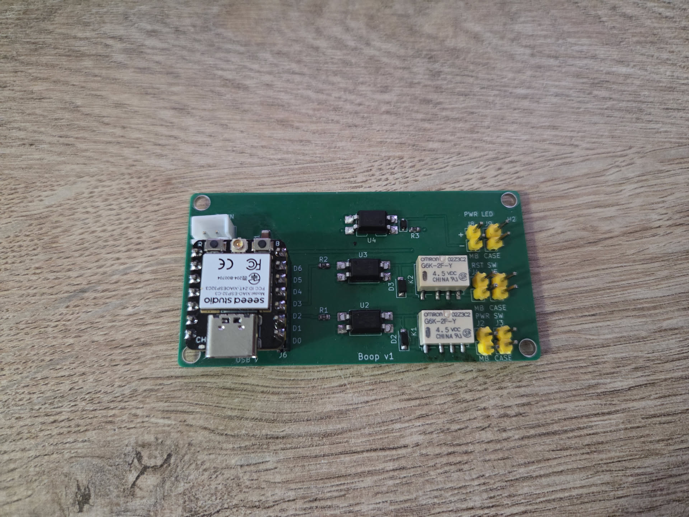

# Boop

A small board that lets ESPHome press the power and reset buttons on a PC, and tell whether the PC is actually on.


<div style="text-align: center;">


</div>


It carries a Seeed XIAO ESP32-C3 on sockets. Two relays sit in parallel with the
front-panel power and reset buttons, so the real buttons keep working. A third
input watches the power LED header so Home Assistant knows the state instead of
guessing.

<div style="text-align: center;">



</div>

**Status:** designed and checked (ERC clean, DRC has no errors, JLCPCB's
pre-flight passes). The first board has been built and soldered, and it works.

## How it works

```
D2 (GPIO4) -> 150R -> opto -> relay K1 -> in parallel with the PWR button
D3 (GPIO5) -> 150R -> opto -> relay K2 -> in parallel with the RESET button
D1 (GPIO3) <- opto <- motherboard PWR LED header (low = PC is on)
```

- Each relay coil is switched by an LTV-817S opto (rank D, so there is enough
  gain to drive a 23 mA coil) with a 1N4148W flyback diode.
- The LED sense side is an opto with a 470R series resistor and a 10k pull-up to
  3V3. A small diode across its LED protects it if the wires are swapped.
- The board is fed 5 V either from the motherboard USB header (through a
  Schottky, so nothing flows back into the PC) or from the XIAO's own USB-C. If
  both are connected the higher one wins. One thing to avoid: the XIAO's 5 V pin
  is wired straight to USB VBUS, so if the header feeds the board while the
  USB-C is plugged into a computer that is switched off, the board pushes 5 V
  into that computer's port. Unplug the USB-C when you are done flashing.

Heads up: for the PC to be startable from off, the motherboard USB 5 V has to stay
alive in shutdown. Many boards turn it off unless you enable something like "USB
standby power" or disable ErP in the BIOS. If yours cuts it, power the board
from the USB-C instead.

## Connectors

All the 2-pin headers are 2.54 mm. The left column is always the motherboard
side and the right column is always the case side, so it is the same on every
pair.

| Ref | Label | Goes to |
|-----|-------|---------|
| J1  | 5V IN | JST XH 2-pin, `+` and `-` are marked. Optional 5 V from the motherboard USB header (pin 1 VCC, pin 7 GND) |
| J2  | PWR SW / MB | motherboard power switch header |
| J3  | PWR SW / CASE | the case power button lead |
| J4  | RST SW / MB | motherboard reset header |
| J5  | RST SW / CASE | the case reset button lead |
| J8  | PWR LED / MB | motherboard power LED header, `+` marked |
| J9  | PWR LED / CASE | the case power LED lead, `+` marked |
| J6, J7 | XIAO | 1x7 female sockets, pin names are printed on the board |

The relay contacts are volt-free, so polarity on the button headers does not
matter. The LED pair does have a polarity, follow the `+`.

Four M3 holes in the corners for standoffs.

## ESPHome

The full config is in [`boop-esphome.yaml`](boop-esphome.yaml). Pins are the XIAO
ESP32-C3 D-numbers: D1 = GPIO3, D2 = GPIO4, D3 = GPIO5.

It exposes three buttons to Home Assistant (power tap, power hold for force off,
reset) and a "PC is on" sensor. The relays are internal and always start off, so
a reboot can't hold a button down.

Create a `secrets.yaml` next to it with `wifi_ssid`, `wifi_password`,
`boop_api_key` (`openssl rand -base64 32`), `boop_ota_password` and
`boop_ap_password`, then flash the first time over USB:

```
esphome run boop-esphome.yaml
```

If the board isn't detected, hold BOOT, tap RESET, release BOOT. Unplug J1
(the motherboard 5 V) while flashing over USB-C. Later updates go over Wi-Fi.

## Building it

Everything you need for JLCPCB is in `fab/`.


## Things worth knowing

- The XIAO ESP32-C3 uses an external antenna. A metal PC case eats Wi-Fi, so
  route the antenna out of the case.
- The relays are the 4.5 V coil version (G6K-2F-Y DC4.5), on purpose. The coil
  only sees the 5 V rail minus the Schottky drop and the opto's saturation
  voltage, which is about 4.0 to 4.3 V at the USB minimum of 4.75 V (the opto's
  saturation voltage at 20-odd mA is not in the datasheet, I assumed 0.2 to
  0.4 V from the curves). A 5 V coil needs 4.0 V to pull in, which is too thin;
  the 4.5 V one pulls in at 3.6 V. Worth measuring the coil voltage on the first
  board.


## Licence

Copyright 2026 Dejan Noveski. Released under
[CC BY-SA 4.0](https://creativecommons.org/licenses/by-sa/4.0/), the full text
is in `LICENSE`. In plain words: build it, sell it, change it, as long as you
credit me and share your changes under the same licence. That covers the
schematic, the board, the Gerbers, the script and the ESPHome example.

The exception is `lib/`, which holds trimmed copies of KiCad's stock libraries.
Those keep their own licence, see `lib/NOTICE.md`.
